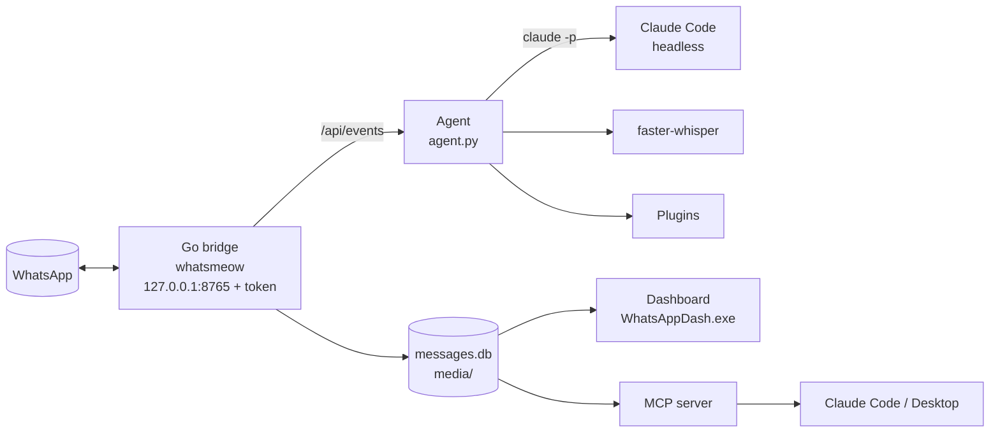

# WhatsApp ↔ Claude Bridge

**Talk to Claude from WhatsApp, and let Claude read and manage your WhatsApp — safely.**
An enhanced fork of [lharries/whatsapp-mcp](https://github.com/lharries/whatsapp-mcp) for Windows: a hardened WhatsApp bridge,
an always-on agent, a desktop dashboard and a Claude Code MCP server.

[עברית ← README.he.md](README.he.md)

> ⚠️ This connects to your **personal WhatsApp as an unofficial linked device** (via [whatsmeow](https://github.com/tulir/whatsmeow)).
> It is not affiliated with WhatsApp or Meta. Automated messaging can get a number restricted — this tool is built to
> minimise that (drafts by default, pacing, automatic back-off), but you use it at your own risk.

## What it does

| | |
|---|---|
| 💬 **Chat with Claude from WhatsApp** | Write or record a voice note in your private "Claude" group; a headless Claude Code session answers (👀 on receipt, ✅ when done, files back as attachments). |
| 📝 **Drafts, not sends** | Anything addressed to other people becomes a draft card with a `wa.me` link you review and send yourself. Auto-send only on your explicit, time-limited permission. |
| 🛡️ **Account safety** | Human-like pacing (3–7 s, typing indicator, daily caps), and an automatic pause when WhatsApp signals throttling or a temporary ban. |
| 🎙️ **Voice transcription** | Every voice note transcribed locally with faster-whisper (default model: Hebrew `ivrit-ai`; any Whisper model works). |
| 🔄 **Reliable sync** | Push events (`/api/events`), exactly-once processing, media saved on arrival (never expires), edits/deletes tracked, polls with decrypted votes, LID↔phone contacts merged. |
| 🖥️ **Dashboard app** | `WhatsAppDash.exe`: connection uptime, your conversation with the tool, send mode, drafts, transcripts, costs, logs. Works offline and without the agent. Hebrew / English, light / dark, self-updating. |
| 🔌 **Claude Code MCP server** | Search messages + transcripts, list polls and votes, drafts, react, send (with quoted replies), download media, status. |
| 💾 **Backups & health** | Nightly backup of databases and media, Windows notification when WhatsApp is disconnected, daily Claude budget cap, plugins for your own projects. |

## Architecture



## Install (Windows 10/11)

Requirements: [uv](https://docs.astral.sh/uv/), [Claude Code](https://docs.claude.com/claude-code) (for chatting from WhatsApp).
Building the bridge yourself needs Go + a C compiler (MSYS2 gcc); otherwise setup downloads the prebuilt bridge.

```bat
git clone https://github.com/WallaBoohi/whatsapp-claude-bridge.git
cd whatsapp-claude-bridge
setup.cmd
```

The wizard: links your WhatsApp (QR) → finds your control group (create a group with only you and write `claude-setup`) →
writes the config → installs components → registers the `whatsapp` MCP server → starts everything at logon →
installs the dashboard → runs the self-test.

### Add it to Claude Code as a plugin

After `setup.cmd`, install the plugin (MCP tools + a WhatsApp skill) in any Claude Code session:

```text
/plugin install whatsapp-bridge --marketplace WallaBoohi/whatsapp-claude-bridge
```

or from a shell: `claude plugin marketplace add WallaBoohi/whatsapp-claude-bridge` then `claude plugin install whatsapp-bridge@wallaboohi`.
When asked, point **WhatsApp bridge folder** at the folder where you ran `setup.cmd`.

## Everyday use

- **Chat:** write in your Claude group. Start a message with `!` to bypass the daily budget cap.
- **Send mode:** dashboard → "Drafts only" / "Auto send for an hour"; pause / resume.
- **Self-test:** `uv run python -X utf8 tools/selftest.py` (`--quiet` sends nothing).
- **Personal instructions for Claude:** edit `agent/home/CLAUDE.md` (not committed).
- **Plugins:** a Python file with `setup(agent)` listed under `"plugins"` in `agent/config.json` — see `agent/agent.py` for the hooks.

## Configuration

| File | What |
|---|---|
| `agent/config.json` | control group, owner name, language (`he`/`en`), budget, transcription, backups, plugins (template: `config.example.json`) |
| `whatsapp-bridge/store/send_policy.json` | owner chats, control group, `draft`/`auto`, pause |
| env `WA_DAILY_CAP`, `WA_NEW_CHATS_PER_DAY`, `WA_MIN_GAP_MS`, `WA_JITTER_MS`, `WA_SAME_CHAT_GAP_MS` | bridge pacing |

## Development

```bat
cd whatsapp-bridge && go test ./...
cd agent && uv run --group dev pytest -q tests
uv run --no-project python tools/release_dash.py 1.2.0 "what changed"
```

Releases (tags `v*`) build the bridge and the dashboard in GitHub Actions and publish them with `latest.json`, which installed dashboards use for updates.

## Credits & license

MIT. Original WhatsApp MCP server by Luke Harries; enhancements by WallaBoohi (with Claude). See [LICENSE](LICENSE) and [SECURITY.md](SECURITY.md).
